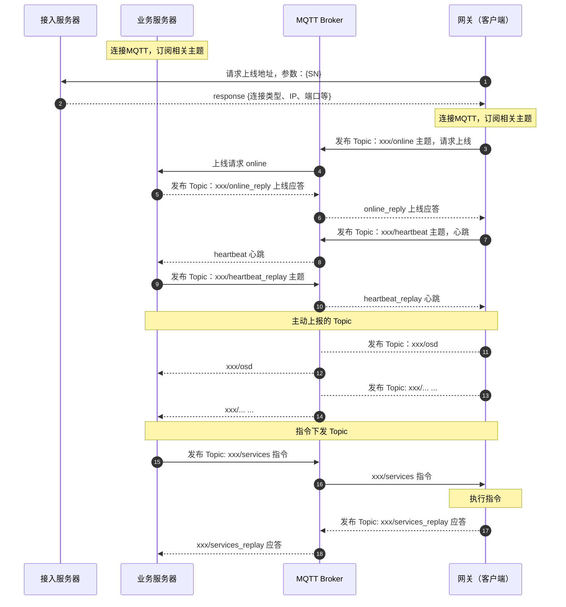
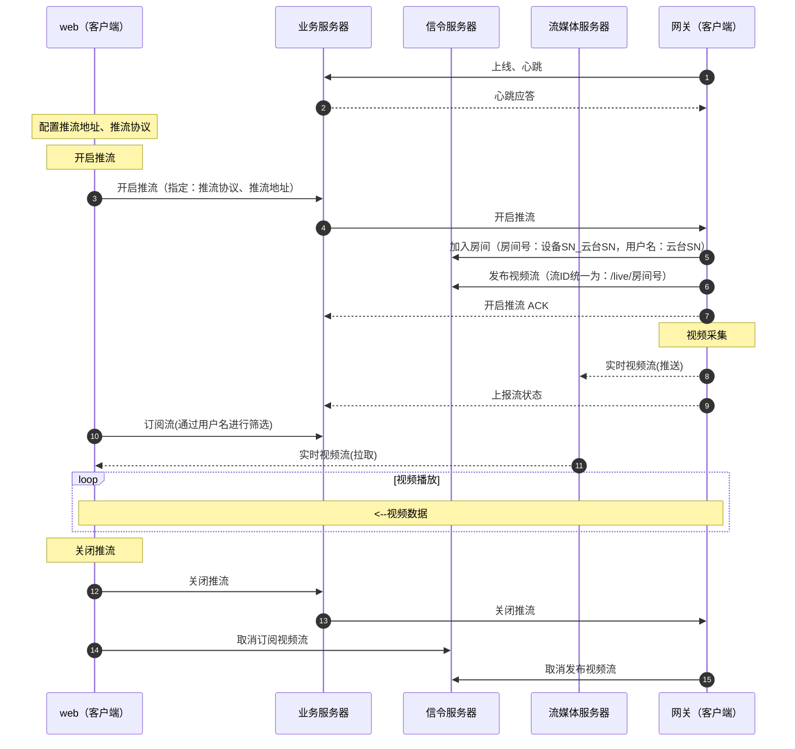
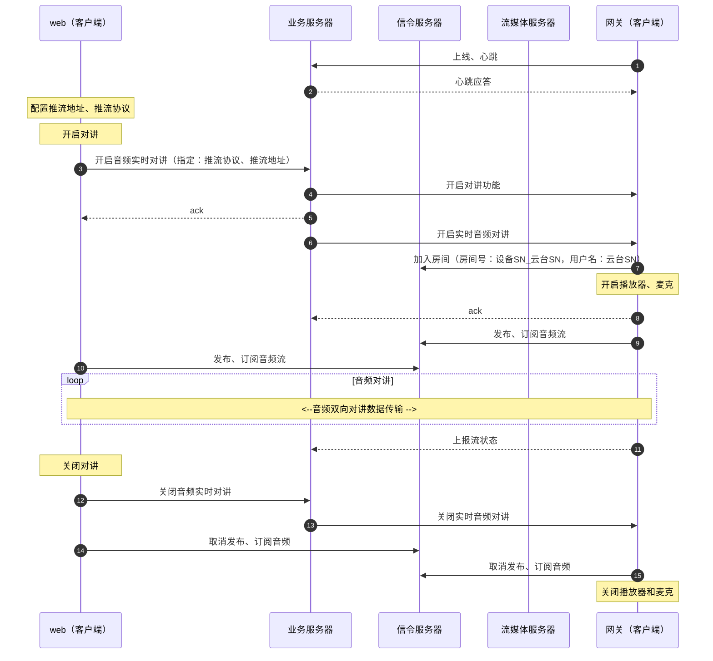
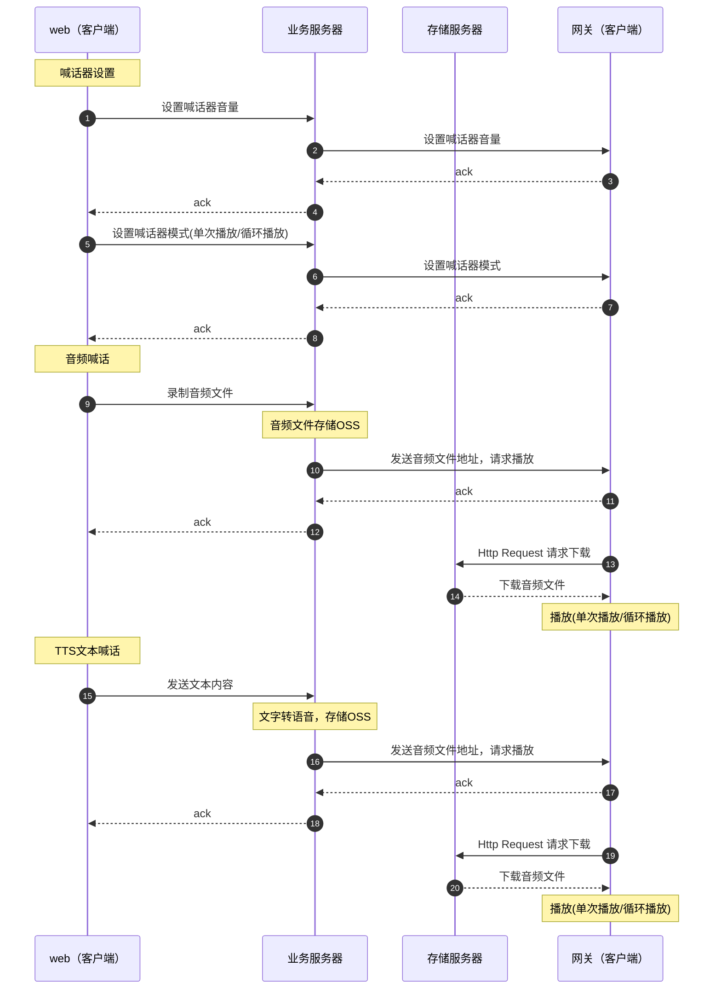
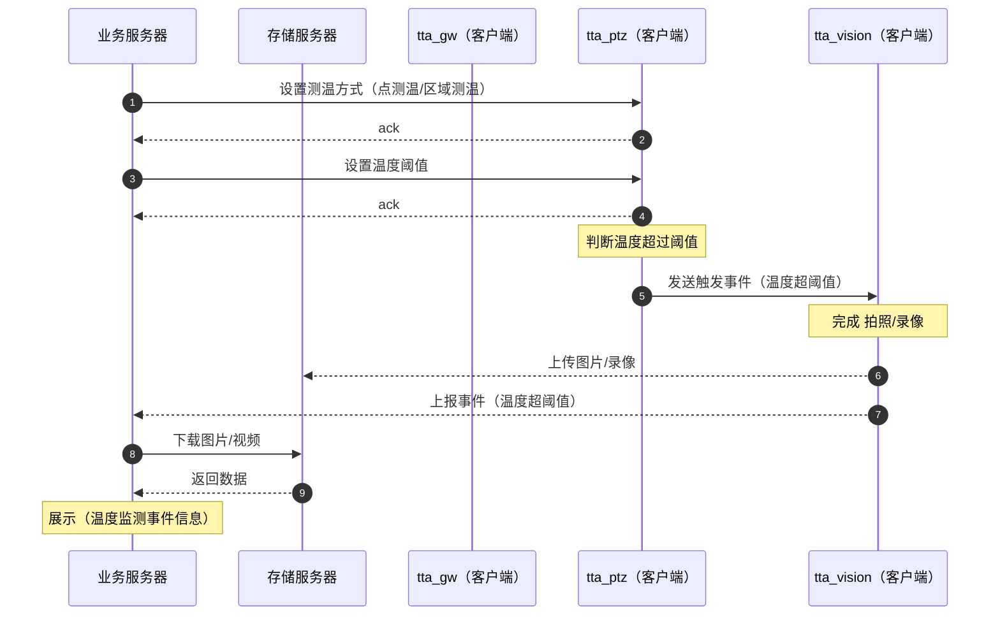
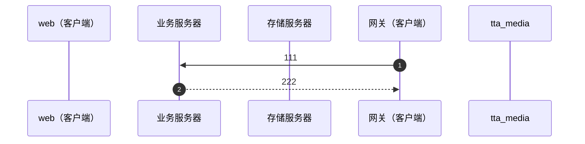

# MQTT通信协议-智身机器狗

## 接入服务器返回的上线信息

```json
MQTT通信协议-智身机器狗{
   "data": {
    "cpuId": 1209039909594066,
    "rtlus_ip": "124.126.230.115",
     "model": zsl-1w,
    "rtlus_port": 10051,
    "rtmp_url": "rtmp://rtmp.ttaviation.com/live/%s_%s",
    "server_name": "test-udp",
    "server_type": "udp/mqtt" 
    "srt url": "srt: //172.17.1:10080?streamid=#!: :h=live/%s_%s,m=publish",
    "stream provider":"srs",
    "stream_type": "rtmp"
    "stream_url": "rtmp: //media.ttaviation.com/live/%s_%s",
    "stream_urls"：[
       "rtmp: //media.ttaviation.com/live/072123123_124567?auth_key1",
        "rtmp: //media.ttaviation.com/live/072123123_121323?auth_key2"
     ]，
    "ts":1735293944
}
// server_type：udp云控上线，mqtt是平安校园，ip和端口都用rtlus_ip和rtlus_port；

```

## 上线状态

**上线状态上报：tta/{type}/status/online 设备 -> 服务器**

**响应：tta/{type}/status/online\_reply 服务器 -> 设备**

| 参数名 | 说明 |
| --- | --- |
| type | 设备类型    无人机：uav；机器狗：robotdog |

```json
{
 "sn":"1209039909594066",
 "type":"robotdog",
 "ts":1760093093502
}

type:设备类型    无人机：uav；机器狗：robotdog
sn：序列号
```
```json
{
 "sn":"1209039909594066",
 "type":"robotdog",
 "result":0,
 "ts":1760093093502
}
```

## 获取oss存储配置

**topic：tta/robotdog/{sn}/request 设备 -> 服务器**

**响应topic****：****tta/robotdog/{sn}/request\_reply 服务器 -> 设备**

```json
{
  "method": "oss_config_get",
  "ts": 1760093093502
}
```
```json
{
  "method": "oss_config_get",
  "result": 0,
  "data": {
      "bucket": "dji-cloud-tta",
      "credentials": {
        "accessKeyId": "STS.NXYSXSbp1sgzU...",
        "accessKeySecret": "AcAjsKvLs5Zs...",
        "expire": 3300,
        "securityToken": "CAISwAJ1q6Ft5B2yfSjIr5vsGOL..."
      },
      "endpoint": "https://oss-cn-beijing.aliyuncs.com",
      "objectKeyPrefix": "media",
      "provider": "ali",
      "region": "cn-beijing"
  },
  "timestamp": 1784518779333
}
//credentials: STS临时凭证信息
//expire：过期时间，单位秒
//provider：厂商：ali、minio
```

## 心跳

**topic：tta/robotdog/{sn}/heartbeat 设备 -> 服务器**

**响应topic****：****tta/robotdog/{sn}/heartbeat\_reply 服务器 -> 设备**

```json
{
  "seq":1,
  "ts":1760093093502
}
```
```json
{
  "seq":1,
  "ts":1760093093502
}
```

## 控制

**topic：tta/robotdog/{sn}/services 服务器 -> 设备**

**响应topic**：**tta/robotdog/{sn}/services\_reply 设备 -> 服务器**

### 控制权切换

```json
{
  "method":"controllor",
  "tid":"",
  "target":"vfc",
  "data":{
     "owner":1
  },
  "ts":1760093093502
}

// owner - 1:sdk控制，2：手柄遥控器，3：建图
```
```json
{
  "tid": "c2a3bcad-3dca3dc-aac3ea31da",
  "ts": 1760093093502,
  "target": "vfc",
  "method": "controllor",
  "data": {
    "result": 0,
    "msg": ""
  }
}
```

### SDK模式切换

```json
{
  "method":"ctrl_mode",
  "tid":"",
  "target":"vfc",
  "data":{
     "mode":1
  },
  "ts":1760093093502
}

// mode - 1:sdk巡航模式，3：普通sdk模式
```
```json
{
  "tid": "c2a3bcad-3dca3dc-aac3ea31da",
  "ts": 1760093093502,
  "target": "vfc",
  "method": "ctrl_mode",
  "data": {
    "result": 0,
    "msg": ""
  }
}
```

### 基础控制

```json
{
  "method":"move",
  "tid":"",
  "target":"vfc",
  "data":{
      "vx":1.0,
      "vy":0,
      "yaw_rate":0
  },
  "ts":1760093093502
}
//vx:前向速度（前进方向）  不进行移动时需传入0,范围（-1m/s ~ -0.05m/s; 0.05m/s ~ 1m/s）
//vy:侧向速度（左右平移） 不进行移动时需传入0,范围（-1.0m/s ~ -0.1m/s;0.1m/s ~ 1.0m/s）
//yaw_rate:绕Z轴角速度（旋转速率） 不进行移动时需传入0,范围（-1.0rad/s ~ -0.02rad/s;0.02rad/s ~ 1.0rad/s）
```
```json
{
  "method":"jump",
  "tid":"",
  "target":"vfc",
  "data":{
     
  },
  "ts":1760093093502
}
```
```json
{
  "method":"passive",
  "tid":"",
  "target":"vfc",
  "data":{
     
  },
  "ts":1760093093502
}
```
```json
{
  "method":"lie_down",
  "tid":"",
  "target":"vfc",
  "data":{
     
  },
  "ts":1760093093502
}
```
```json
{
  "method":"stand_up",
  "tid":"",
  "target":"vfc",
  "data":{
     
  },
  "ts":1760093093502
}
```
```json
{
  "method":"back_flip",
  "tid":"",
  "target":"vfc",
  "data":{
     
  },
  "ts":1760093093502
}
```
```json
{
  "method":"front_jump",
  "tid":"",
  "target":"vfc",
  "data":{
     
  },
  "ts":1760093093502
}
```
```json
{
  "method":"shake_hand",
  "tid":"",
  "target":"vfc",
  "data":{
     
  },
  "ts":1760093093502
}
```
```json
{
  "method":"two_leg_stand",
  "tid":"",
  "target":"vfc",
  "data":{
     "vx":1.0,
      "yaw_rate":0
  },
  "ts":1760093093502
}
//vx:前向速度（前进方向）  不移动则传入0,范围（-0.5~-0.2 / 0.2~0.5m/s）
//yaw_rate:绕Z轴角速度（旋转速率） 不移动则传入0,范围（-1~-0.2 / 0.2~1.0rad/s）
```
```json
{
  "method":"attitude_control",
  "tid":"",
  "target":"vfc",
  "data":{
     "roll_vel":10,
     "pitch_vel":0,
     "yaw_vel":0,
     "height_vel":0
  },
  "ts":1760093093502
}
//roll_vel:绕X轴角速度 不进行控制则传入0,范围（-0.5rad/s~0.5rad/s）
//pitch_vel:绕Y轴角速度 不进行控制则传入0,范围（-0.5rad/s~0.5rad/s）
//yaw_vel:绕Z轴角速度 不进行控制则传入0,范围（-0.5rad/s~0.5rad/s）
//height_vel:垂直高度速度 不进行控制则传入0,范围（-0.5m/s-0.5m/s）
```
```json
{
  "tid": "c2a3bcad-3dca3dc-aac3ea31da",
  "ts": 1760093093502,
  "target": "vfc",
  "method": "move",
  "data": {
    "result": 0,
    "msg": ""
  }
}
```

| 参数名 | 说明 |
| --- | --- |
| method | 功能指令：<br>机器狗运动：move<br>垂直跳跃（向上跳）：jump<br>趴下(卧倒)：passive<br>站立：stand\_up<br>半蹲：lie\_down<br>后空翻：back\_flip<br>向前跳：front\_jump<br>打招呼：shake\_hand<br>双腿站立：two\_leg\_stand<br>退出双腿站立：cancel\_two\_leg\_stand<br>姿态与高度控制:attitude\_control |
| tid | 业务端使用的事务id |
| target | 目标模块； vfc:发给VFC模块，ptz:发给PTZ模块，vision:发给Vision模块 |
| data | 参数传参 |
| ts | utc时间 |

###  云台控制

*   **云台速度控制(上下左右)**
    

```json
{
  "method":"gimbal_control",
  "tid":"",
  "target":"ptz",
  "data":{
    "index":1,
    "sn":"12345678",
    "vx":1500,
    "vy":1500
  },
  "ts":1760093093502
}
//gimbal_control:云台速度控制对应云控云台模型的cmd=109
//vx:俯仰角。1500：中值，1000：向下最大值，2000：向上最大值
//vy:航向角。1500：中值，1000：向左最大值，2000：向右最大值
```

*   **复位**
    
    ```json
    {
      "method":"gimbal_reset",
      "tid":"",
      "target":"ptz",
      "data":{
        "index":1,
        "sn":"12345678"
      },
      "ts":1760093093502
    }
    ```
    
*   **一键向下**
    

```json
{
  "method":"gimbal_down",
  "tid":"",
  "target":"ptz",
  "data":{
    "index":1,
    "sn":"12345678"
  },
  "ts":1760093093502
}
```

*   **镜头源切换**
    
    ```json
    {
      "method":"camera_switch",
      "tid":"",
      "target":"ptz",
      "data":{
        "index":1,
        "sn":"12345678",
        "type":1
      },
      "ts":1760093093502
    }
    
    type:
      M3D云盒：
        7：可见光(变焦）
        8：红外 
        9：可见光(广角）
      其它机型：
        1-可见光(变焦）
        2-红外 
        3-广角 
    ```
    
*   **变焦**
    

```json
{
  "method":"camera_focal_length_set",
  "tid":"",
  "target":"ptz",
  "data":{
    "index":1,
    "sn":"12345678",
    "type":1
  },
  "ts":1760093093502
}

type:变焦类型：
  1-持续放大
  2-持续缩小
  3-停止变焦
  4-ZOOM-1
  5-放大2倍
  6-缩小2倍
```

### 相机控制

*   **拍照**
    
    ```json
    {
      "method":"take_photo",
      "tid":"",
      "target":"vision",
      "data":{
        "index":1,
        "sn":"12345678"
      },
      "ts":1760093093502
    }
    ```
    
*   **录像**
    

```json
{
  "method":"camera_recording",
  "tid":"",
  "target":"vision",
  "data":{
    "index":1,
    "sn":"12345678",
    "mode":1
  },
  "ts":1760093093502
}
//mode:录像模型：1：开始录开始，0停止录像
```

### 直播推流控制

*   **开启/关闭推流**
    

```json
{
  "method":"camera_livestream",
  "tid":"",
  "target":"vision",
  "data":{
    "index":1,
    "sn":"12345678",
    "state":1,
    "stream_type": "rtmp",
    "stream_url": "rtmp: //media.ttaviation.com/live/%s_%s",
    "mode":1
  },
  "ts":1760093093502
}

state:推流控制
  1：开启
  2.关闭
stream_type：流类型  rtmp/webrtc
mode:
  1.音频
  2.视频
  3.音视频
```
```json
//成功
{
  "tid": "14983950-01a9-4dc6-99d5-b493ac94e138",
  "bid": "14875598-eed8-4197-9b64-feab8e9059ed",
  "ts": 1786436257296,
  "target": "vision",
  "method": "camera_livestream",
  "data": {
    "result": 0,
    "msg": "",
    "data": {
      "index": 1,
      "livestream_enabled": true,
      "mode": "processed",
      "msg": "",
      "result": 0,
      "sn": "002",
      "stream_id": "video1",
      "type": "camera"
    }
  }
}
//失败
{
  "tid": "d3385c34-72b9-4620-afe6-8c63cfc9f5a6",
  "bid": "95956cf9-cab9-4bfe-aaaf-30f73c0e1362",
  "ts": 1786180837660,
  "target": "vision",
  "method": "camera_livestream",
  "data": {
    "result": 0,
    "msg": "",
    "data": {
      "msg": "data.index maps to a disabled stream",
      "result": 1
    }
  }
}
```

*   **直播镜头切换(可见光/红外)**
    

```json
{
  "tid": "d3385c34-72b9-4620-afe6-8c63cfc9f5a6",
  "bid": "e3385c34-32b9-1620-afe6-8c63cfc9f5a1",
  "timestamp": 1697000000000,
  "method": "live_lens_change",
  "target": "ptz",
  "data": {
    "sn": "001",
    "index":0,
    "video_type": 0
  }
}
//sn：相机sn
//index: 相机序号
//video_type: 镜头类型 1=可见光, 2=红外(红外时不可以变焦), 3=可见光和红外拼接
```
```json
{
  "tid": "d3385c34-72b9-4620-afe6-8c63cfc9f5a6",
  "bid": "e3385c34-32b9-1620-afe6-8c63cfc9f5a1",
  "timestamp": 1697000000001,
  "method": "live_lens_change",
  "data": {
    "result": 0
  }
}
```

*   **调色盘设置**
    

```json
{
  "tid": "d3385c34-72b9-4620-afe6-8c63cfc9f5a6",
  "bid": "e3385c34-32b9-1620-afe6-8c63cfc9f5a1", 
  "timestamp": 1697000000000,
  "method": "ir_palette_set",
  "target": "ptz",
  "data": {
    "sn": "001", 
    "index":0
    "palette_style": 0 
  }
}
```
```json
{
  "tid": "d3385c34-72b9-4620-afe6-8c63cfc9f5a6",
  "bid": "e3385c34-32b9-1620-afe6-8c63cfc9f5a1",
  "timestamp": 1697000000001,
  "method": "ir_palette_set",
  "data": {
    "result": 0
  }
}
```

###  建图控制

*   **开始建图**
    
    ```json
    {
      "method":"start_mapping",
      "tid":"c2a3bcad-3dca3dc-aac3ea31da",
      "bid":"c2a3bcad-3dca3dc-aac3ea31da",
      "target":"vfc",
      "data":{},
      "ts":1760093093502
    }
    
    ```
    ```json
    {
      "tid": "c2a3bcad-3dca3dc-aac3ea31da",
      "bid":"c2a3bcad-3dca3dc-aac3ea31da",
      "ts": 1760093093502,
      "target": "vfc",
      "method": "start_mapping",
      "data": {
        "result": 0,
        "msg": ""
      }
    }
    ```
    
*   **停止建图**
    
    ```json
    {
      "method":"stop_mapping",
      "tid":"c2a3bcad-3dca3dc-aac3ea31da",
      "bid":"c2a3bcad-3dca3dc-aac3ea31da",
      "target":"vfc",
      "data":{},
      "ts":1760093093502
    }
    
    ```
    ```json
    {
      "tid": "c2a3bcad-3dca3dc-aac3ea31da",
      "bid":"c2a3bcad-3dca3dc-aac3ea31da",
      "ts": 1760093093502,
      "target": "vfc",
      "method": "stop_mapping",
      "data": {
        "result": 0,
        "msg": ""
      }
    }
    ```
    
*   **获取PGM地图列表**
    
    ```json
    {
      "method":"get_all_compressed_pgm_map",
      "tid":"c2a3bcad-3dca3dc-aac3ea31da",
      "bid":"c2a3bcad-3dca3dc-aac3ea31da",
      "target":"vfc",
      "data":{},
      "ts":1760093093502
    }
    
    ```
    ```json
    {
      "tid": "d488350c-b438-4251-8dc4-00cc629c854f",
      "bid": "bab2633e-1272-4c83-a532-bfafe637142a",
      "ts": 1785289939309,
      "target": "vfc",
      "method": "get_all_compressed_pgm_map",
      "data": {
        "result": 0,
        "msg": "",
        "data": {
          "2026_07_25_13_53_48": [
            {
              "header": {
                "frame_id": "map",
                "stamp": {
                  "nanosec": 0,
                  "sec": 0
                }
              },
              "info": {
                "height": 351,
                "map_load_time": {
                  "nanosec": 233,
                  "sec": 100
                },
                "origin": {
                  "orientation": {
                    "w": 1,
                    "x": 0,
                    "y": 0,
                    "z": 0
                  },
                  "position": {
                    "x": -13.65,
                    "y": -10.45,
                    "z": 0
                  }
                },
                "resolution": 0.05,
                "width": 384
              },
              "map_type": "rtk"
            },
            []
          ],
          "2026_07_25_14_12_03": [
            {
              "header": {
                "frame_id": "map",
                "stamp": {
                  "nanosec": 0,
                  "sec": 0
                }
              },
              "info": {
                "height": 272,
                "map_load_time": {
                  "nanosec": 233,
                  "sec": 100
                },
                "origin": {
                  "orientation": {
                    "w": 1,
                    "x": 0,
                    "y": 0,
                    "z": 0
                  },
                  "position": {
                    "x": -8.4,
                    "y": -6.6,
                    "z": 0
                  }
                },
                "resolution": 0.05,
                "width": 322
              },
              "map_type": "rtk"
            },
            []
          ],
          "2026_07_25_14_12_51": [
            {
              "header": {
                "frame_id": "map",
                "stamp": {
                  "nanosec": 0,
                  "sec": 0
                }
              },
              "info": {
                "height": 287,
                "map_load_time": {
                  "nanosec": 233,
                  "sec": 100
                },
                "origin": {
                  "orientation": {
                    "w": 1,
                    "x": 0,
                    "y": 0,
                    "z": 0
                  },
                  "position": {
                    "x": -7.7,
                    "y": -6.8,
                    "z": 0
                  }
                },
                "resolution": 0.05,
                "width": 321
              },
              "map_type": "rtk"
            },
            []
          ],
          "2026_07_25_15_16_06": [
            {
              "header": {
                "frame_id": "map",
                "stamp": {
                  "nanosec": 0,
                  "sec": 0
                }
              },
              "info": {
                "height": 267,
                "map_load_time": {
                  "nanosec": 233,
                  "sec": 100
                },
                "origin": {
                  "orientation": {
                    "w": 1,
                    "x": 0,
                    "y": 0,
                    "z": 0
                  },
                  "position": {
                    "x": -8,
                    "y": -6.7,
                    "z": 0
                  }
                },
                "resolution": 0.05,
                "width": 325
              },
              "map_type": "rtk"
            },
            []
          ],
          "2026_07_28_14_13_53": [
            {
              "header": {
                "frame_id": "map",
                "stamp": {
                  "nanosec": 0,
                  "sec": 0
                }
              },
              "info": {
                "height": 331,
                "map_load_time": {
                  "nanosec": 233,
                  "sec": 100
                },
                "origin": {
                  "orientation": {
                    "w": 1,
                    "x": 0,
                    "y": 0,
                    "z": 0
                  },
                  "position": {
                    "x": -13.65,
                    "y": -7.15,
                    "z": 0
                  }
                },
                "resolution": 0.05,
                "width": 450
              },
              "map_type": "rtk"
            },
            []
          ]
        }
      }
    }
    ```
    
*   **获取地图列表**
    
    ```json
    {
      "method":"get_map_list",
      "tid":"c2a3bcad-3dca3dc-aac3ea31da",
      "bid":"c2a3bcad-3dca3dc-aac3ea31da",
      "target":"gw",
      "data":{},
      "ts":1760093093502
    }
    
    ```
    ```json
    {
      "tid": "c2a3bcad-3dca3dc-aac3ea31da",
      "bid":"c2a3bcad-3dca3dc-aac3ea31da",
      "ts": 1760093093502,
      "target": "gw",
      "method": "get_map_list",
      "data": {
        "result": 0,
        "msg": "",
        "data":[
          {
            "map_id":"2026_07_25_13_53_48",
            "size":1024
          }
        ]
      }
    }
    //map_id:地图id
    //size:文件夹下所有文件总大小，单位MB
    ```
    
*   **获取PGM地图（****未使用****）**
    
    ```json
    {
      "method":"get_pgm_map",
      "tid":"c2a3bcad-3dca3dc-aac3ea31da",
      "target":"vfc",
      "data":{
        "map_id":1
      },
      "ts":1760093093502
    }
    
    ```
    ```json
    {
      "tid": "c2a3bcad-3dca3dc-aac3ea31da",
      "ts": 1760093093502,
      "target": "vfc",
      "method": "get_pgm_map",
      "data": {
        "result": 0,
        "msg": ""
      }
    }
    ```
    
*   **删除地图**
    
    ```json
    {
      "method":"remove_map_by_id",
      "tid":"c2a3bcad-3dca3dc-aac3ea31da",
      "target":"vfc",
      "data":{
        "map_ids":["",""]
      },
      "ts":1760093093502
    }
    
    ```
    ```json
    {
      "tid": "c2a3bcad-3dca3dc-aac3ea31da",
      "ts": 1760093093502,
      "target": "vfc",
      "method": "remove_map_by_id",
      "data": {
        "result": 0,
        "msg": ""
      }
    }
    ```
    
*   **重命名地图**
    

```json
{
  "method":"rename_map_name",
  "tid":"c2a3bcad-3dca3dc-aac3ea31da",
  "target":"vfc",
  "data":{
    "map_id":"",
    "new_name":""
  },
  "ts":1760093093502
}

```
```json
{
  "tid": "c2a3bcad-3dca3dc-aac3ea31da",
  "ts": 1760093093502,
  "target": "vfc",
  "method": "rename_map_name",
  "data": {
    "result": 0,
    "msg": ""
  }
}
```

### 导航路径管理（未使用）

*   **获取指定地图下的所有导航路径**
    

```json
{
  "method":"get_all_paths",
  "tid":"c2a3bcad-3dca3dc-aac3ea31da",
  "target":"vfc",
  "data":{
    "map_id":""
  },
  "ts":1760093093502
}

```
```json
{
  "tid": "c2a3bcad-3dca3dc-aac3ea31da",
  "ts": 1760093093502,
  "target": "vfc",
  "method": "get_all_paths",
  "data": {
    "result": 0,
    "msg": "",
    "data": [
        "map_id",
        ["path_id_1", "path_id_2"],
        {
          "path_id_1": [
            ["point_name_1", {
              "position": {"x": 1.0, "y": 2.0, "z": 0.0},
              "orientation": {"x": 0.0, "y": 0.0, "z": 0.0, "w": 1.0}
            }],
            ["point_name_2", {...}]
          ],
          "path_id_2": [...]
        }
      ]
  }
}
```

*   **添加新的导航路径**
    

```json
{
  "method":"add_nav_path",
  "tid":"c2a3bcad-3dca3dc-aac3ea31da",
  "target":"vfc",
  "data":{
    "map_id",
    "path_id",
    [
      [
        "point_name_1", 
        {
          "position": {"x": 1.0, "y": 2.0, "z": 0.0},
          "orientation": {"x": 0.0, "y": 0.0, "z": 0.0, "w": 1.0}
        }
    ],
      ["point_name_2", {...}]
    ]
  },
  "ts":1760093093502
}

```
```json
{
  "tid": "c2a3bcad-3dca3dc-aac3ea31da",
  "ts": 1760093093502,
  "target": "vfc",
  "method": "add_nav_path",
  "data": {
    "result": 0,
    "msg": ""
  }
}
```

*   **删除导航路径**
    

```json
{
  "method":"remove_nav_path",
  "tid":"c2a3bcad-3dca3dc-aac3ea31da",
  "target":"vfc",
  "data":{
    ["map_id_1", "path_id_1"],
    ["map_id_2", "path_id_2"]
}
```
```json
{
  "tid": "c2a3bcad-3dca3dc-aac3ea31da",
  "ts": 1760093093502,
  "target": "vfc",
  "method": "remove_nav_path",
  "data": {
    "result": 0,
    "msg": ""
  }
}
```

### 导航控制

*   开始导航
    

```json
{
  "method":"start_nav",
  "tid":"c2a3bcad-3dca3dc-aac3ea31da",
  "target":"vfc",
  "data":{
    "position": {"x": 1.0, "y": 2.0, "z": 0.0},
    "orientation": {"x": 0.0, "y": 0.0, "z": 0.0, "w": 1.0}
  }
}
```
```json
{
  "tid": "c2a3bcad-3dca3dc-aac3ea31da",
  "ts": 1760093093502,
  "target": "vfc",
  "method": "start_nav",
  "data": {
    "result": 0,
    "msg": ""
  }
}
```

*   通过路径id 开始多点导航
    
    ```json
    {
      "method":"start_multi_nav",
      "tid":"c2a3bcad-3dca3dc-aac3ea31da",
      "target":"vfc",
      "data":{
        "map_id":"2026_07_25_15_16_06",
        "path_id":"自定义路径1"
      }
    }
    ```
    ```json
    {
      "tid": "c2a3bcad-3dca3dc-aac3ea31da",
      "ts": 1760093093502,
      "target": "vfc",
      "method": "start_multi_nav",
      "data": {
        "result": 0,
        "msg": ""
      }
    }
    ```
    
*   **开始多点导航**
    
    ```json
    {
      "method":"start_multi_nav_by_points",
      "bid":"c2a3bcad3dca3dcaac3ea31da",
      "tid":"c2a3bcad-3dca3dc-aac3ea31da",
      "target":"vfc",
      "data":{
        "map_id":"2026_07_25_15_16_06",
        "task_name":"task_20260804",
        "points":[
          {
            "position": {"x": 1.0, "y": 2.0, "z": 0.0},
            "orientation": {"x": 0.0, "y": 0.0, "z": 0.0, "w": 1.0},
            "actions":[
              {
                "id":"",
                "action":"take_photo",
                "param1":[]
              }
            ]
          },
          {
            "position": {"x": 3.0, "y": 4.0, "z": 0.0},
            "orientation": {"x": 0.0, "y": 0.0, "z": 0.0, "w": 1.0},
            "actions":[
              {
                "id":"",
                "action":"take_photo",
                "param":[]
              }
            ]
          }
        ]
      }
    }
    //bid:任务id
    //task_name:任务名称
    //拍照：action="take_photo"，param=null
    //开始录像：action="start_record",param=null
    //停止录像：action="stop_record",param=null
    //停留：action="pause",param=[10], 10表示停留10秒
    //云台动作：action="gimbal_action",param=[1,1], param数组，第一个数表示转动类型：1-转型指定方向，2-左右扫描一周，3-保持不动；第二个参数是对第一个参数的描述，当第一个参数为1时，第二个参数值 1-正前，2-左 3-右，4-后
    //开启ai识别：action="start_ai",param=[1,2,3];1-人脸 2-车牌 3-人形
    //关闭ai识别：action="stop_ai",param=null
    ```
    ```json
    {
      "tid": "c2a3bcad-3dca3dc-aac3ea31da",
      "ts": 1760093093502,
      "target": "vfc",
      "method": "start_multi_nav_by_points",
      "data": {
        "result": 0,
        "msg": ""
      }
    }
    ```
    
*   **多点导航流程图**
    
    
    
*   **开始返航**
    
    ```json
    {
      "method":"start_nav_return_home",
      "tid":"c2a3bcad-3dca3dc-aac3ea31da",
      "target":"vfc",
      "data":{}
    }
    
    ```
    ```json
    {
      "tid": "c2a3bcad-3dca3dc-aac3ea31da",
      "ts": 1760093093502,
      "target": "vfc",
      "method": "start_nav_return_home",
      "data": {
        "result": 0,
        "msg": ""
      }
    }
    ```
    
*   **停止导航**
    
    ```json
    {
      "method":"stop_nav",
      "tid":"c2a3bcad-3dca3dc-aac3ea31da",
      "target":"vfc",
      "data":{}
    }
    
    ```
    ```json
    {
      "tid": "c2a3bcad-3dca3dc-aac3ea31da",
      "ts": 1760093093502,
      "target": "vfc",
      "method": "stop_nav",
      "data": {
        "result": 0,
        "msg": ""
      }
    }
    ```
    
*   **暂停导航**
    
    ```json
    {
      "method":"pause_nav",
      "tid":"c2a3bcad-3dca3dc-aac3ea31da",
      "target":"vfc",
      "data":{}
    }
    
    ```
    ```json
    {
      "tid": "c2a3bcad-3dca3dc-aac3ea31da",
      "ts": 1760093093502,
      "target": "vfc",
      "method": "pause_nav",
      "data": {
        "result": 0,
        "msg": ""
      }
    }
    ```
    
*   **继续导航**
    

```json
{
  "method":"continue_nav",
  "tid":"c2a3bcad-3dca3dc-aac3ea31da",
  "target":"vfc",
  "data":{}
}

```
```json
{
  "tid": "c2a3bcad-3dca3dc-aac3ea31da",
  "ts": 1760093093502,
  "target": "vfc",
  "method": "continue_nav",
  "data": {
    "result": 0,
    "msg": ""
  }
}
```

###  定位

*   **加载定位地图**
    
    ```json
    {
      "method":"loc_load_map",
      "tid":"c2a3bcad-3dca3dc-aac3ea31da",
      "target":"vfc",
      "data":{
        "map_id":123
      }
    }
    
    ```
    ```json
    {
      "tid": "c2a3bcad-3dca3dc-aac3ea31da",
      "ts": 1760093093502,
      "target": "vfc",
      "method": "loc_load_map",
      "data": {
        "result": 0,
        "msg": ""
      }
    }
    ```
    
*   **重置定位**
    

```json
{
  "method":"loc_reset",
  "tid":"c2a3bcad-3dca3dc-aac3ea31da",
  "target":"vfc",
  "data":{}
}

```
```json
{
  "tid": "c2a3bcad-3dca3dc-aac3ea31da",
  "ts": 1760093093502,
  "target": "vfc",
  "method": "loc_reset",
  "data": {
    "result": 0,
    "msg": ""
  }
}
```

###  AI识别

*   **开启AI**
    

```json
{
  "method":"start_ai",
  "tid":"c2a3bcad-3dca3dc-aac3ea31da",
  "bid":"c2a3bcad-3dca3dc-aac3ea31da",
  "target":"vision",
  "data":{
    "filters": [1]
  }
}
//filters:要识别的目标 1:人脸
```
```json
{
  "tid": "c2a3bcad-3dca3dc-aac3ea31da",
  "bid":"c2a3bcad-3dca3dc-aac3ea31da",
  "ts": 1760093093502,
  "target": "vision",
  "method": "start_ai",
  "data": {
    "result": 0,
    "msg": ""
  }
}
```

*   **关闭AI**
    

```json
{
  "method":"stop_ai",
  "tid":"c2a3bcad-3dca3dc-aac3ea31da",
  "bid":"c2a3bcad-3dca3dc-aac3ea31da",
  "target":"vision",
  "data":{
  }
}
```
```json
{
  "tid": "c2a3bcad-3dca3dc-aac3ea31da",
  "bid": "c2a3bcad-3dca3dc-aac3ea31da",
  "ts": 1760093093502,
  "target": "vision",
  "method": "stop_ai",
  "data": {
    "result": 0,
    "msg": ""
  }
}
```

### 同步点云文件

*   **一键同步**
    

```json
{
  "method":"sync_map_file",
  "tid":"c2a3bcad-3dca3dc-aac3ea31da",
  "bid":"c2a3bcad-3dca3dc-aac3ea31da",
  "target":"gw",
  "data":{
    "map_id":["123","456"],
     "upload_path":"http://a.com/xxx"
  }
}
```
```json
{
  "tid": "c2a3bcad-3dca3dc-aac3ea31da",
  "bid":"c2a3bcad-3dca3dc-aac3ea31da",
  "ts": 1760093093502,
  "method": "sync_map_file",
  "data": {
    "result": 0,
    "msg": "",
  }
}
```

### 媒体文件管理

*   **获取文件列表**
    

```json
{
  "method":"get_media_filelist",
  "tid":"c2a3bcad-3dca3dc-aac3ea31da",
  "bid":"c2a3bcad-3dca3dc-aac3ea31da",
  "ts": 1760093093502,
  "target":"gw",
  "data":{}
}
```
```json
   {
  "method":"get_media_filelist",
  "tid":"c2a3bcad-3dca3dc-aac3ea31da",
  "bid":"c2a3bcad-3dca3dc-aac3ea31da",
  "target":"gw",
  "data":{
    "result": 0,
    "msg": "",
    "data":[
      {
        "id": "dir-001",
        "parent_id": "",
        "file_name": "2026-07-25",
        "node_type": 1,
        "file_type": 0,
        "file_size": 0,
        "ts": 1760093093502,
        "children": [
          {
            "id": "file-001",
            "parent_id": "dir-001",
            "file_name": "IMG_0001.jpg",
            "node_type": 0,
            "file_type": 0,
            "file_size": 51200,
            "ts": 1760093093502,
            "children": null
          },
          {
            "id": "file-002",
            "parent_id": "dir-001",
            "file_name": "VID_0002.mp4",
            "node_type": 0,
            "file_type": 1,
            "file_size": 1048576,
            "ts": 1760093094000,
            "children": null
          }
        ]
      },
      {
        "id": "file-003",
        "parent_id": "",
        "file_name": "root_photo.jpg",
        "node_type": 0,
        "file_type": 0,
        "file_size": 40960,
        "ts": 1760093095000,
        "children": null
      }
    ]
  },
  "ts": 1760093093502
}
//id:文件唯一标识
//parent_id:父节点
//file_name：文件名
//node_tpye:节点类型：0-文件，1-目录
//file_type:文件类型：0-图片，1-视频
//file_size:文件大小
//ts:文件生成时间
//children：子节点
```

### 同步媒体文件

*   **一键同步**
    

```json
{
  "method":"sync_media_file",
  "tid":"c2a3bcad-3dca3dc-aac3ea31da",
  "bid":"c2a3bcad-3dca3dc-aac3ea31da",
  "target":"gw",
  "data":{
     "file_path":["123/345.png","456/678.mp4"],
     "upload_path":"http://a.com/xxx"
  }
}
```
```json
{
  "tid": "c2a3bcad-3dca3dc-aac3ea31da",
  "bid":"c2a3bcad-3dca3dc-aac3ea31da",
  "ts": 1760093093502,
  "method": "sync_media_file",
  "data": {
    "result": 0,
    "msg": "",
    "data":["123/345.png","456/678.mp4"],
    "total":8,
    "state":"1"
  }
}
state: 1上传中，其它上传完成；
```

### 预警事件上报开关

*   **检测结果上报开关**
    

```json
{
  "method":"event_switch",
  "tid":"c2a3bcad-3dca3dc-aac3ea31da",
  "bid":"c2a3bcad-3dca3dc-aac3ea31da",
  "target":"vision",
  "data":{
     "mode":0,
     "upload_path":"http://a.com/xxx/"
  }
}
//mode:检测结果上报开关  0-关闭 1-开启
//upload_path：待上传的文件路径
```

### 喊话器控制

*   **喊话器播放mp3**
    

```json
{
  "method":"speaker_play_start",
  "tid":"c2a3bcad-3dca3dc-aac3ea31da",
  "bid":"c2a3bcad-3dca3dc-aac3ea31da",
  "target":"audio",
  "data":{
    "play_id": "rec-8f3a2c11",
    "url": "https://media.tta-edu.com:9004/safecampus/speaker/9c1e/no-parking.mp3",
    "md5": "9f86d081884c7d659a2feaa0c55ad015",
    "format": "mp3",
    "size": 20480,
    "duration_ms": 3200,
    "preempt": 1
  }
}
//play_id:平台生成的本次播放 id（≤64 字符）。应答需原样回带，便于两边对日志
//url:音频文件下载地址（HTTP/HTTPS，可能是对象存储的签名 URL，有效期有限，不要长期缓存 URL 本身）
//md5:音频文件的 MD5（32 位小写十六进制）。机身用它做完整性校验与本地缓存键
//format:恒为 "mp3"。
//size:文件字节数，便于机身预判存储空间
//duration_ms:音频时长（毫秒）；平台未知时为 0
//preempt:1（默认）= 打断正在播放的内容；0 = 机身正在播放时拒绝result并回 314002
```
```json
{
  "tid": "c2a3bcad-3dca3dc-aac3ea31da",
  "bid":"c2a3bcad-3dca3dc-aac3ea31da",
  "ts": 1760093093502,
  "method": "speaker_play_start",
  "data": {
    "result": 0,
    "msg": ""
  }
}
```

*   **喊话器设置音量**
    

```json
{
  "method":"speaker_volume_set",
  "tid":"c2a3bcad-3dca3dc-aac3ea31da",
  "bid":"c2a3bcad-3dca3dc-aac3ea31da",
  "target":"audio",
  "data":{ "volume": 70 }
}
//volume:机身实际生效的音量 （70%）

```
```json
{
  "tid": "c2a3bcad-3dca3dc-aac3ea31da",
  "bid":"c2a3bcad-3dca3dc-aac3ea31da",
  "ts": 1760093093502,
  "method": "speaker_volume_set",
  "data": {
    "result": 0,
    "msg": ""
  }
}
```

### 红外测温控制

*   **设置测温模式** 
    

```json

{
  "tid": "c2a3bcad-3dca3dc-aac3ea31da",
  "bid": "d1a3bcad-3dca3dc-aac3ea31ef",
  "timestamp": 1697000000000,
  "method": "ir_metering_mode_set",
  "target": "ptz",
  "data": {
    "sn": "002",
    "index":1,
    "video_type": 0
  }
}
```
```json
{
  "tid": "c2a3bcad-3dca3dc-aac3ea31da",
  "bid": "d1a3bcad-3dca3dc-aac3ea31ef",
  "timestamp": 1697000000001,
  "method": "ir_metering_mode_set",
  "data": {
    "result": 0
  }
}
```

*   点测温
    

```json

{
  "tid": "c2a3bcad-3dca3dc-aac3ea31da",
  "bid": "d1a3bcad-3dca3dc-aac3ea31ef",
  "timestamp": 1697000000000,
  "method": "ir_metering_point_set",
  "target": "ptz",
  "data": {
    "sn": "002",
    "index":1,
     "x": 0.5,
     "y": 0.5
  }
}
```
```json
{
  "tid": "c2a3bcad-3dca3dc-aac3ea31da",
  "bid": "d1a3bcad-3dca3dc-aac3ea31ef",
  "timestamp": 1697000000001,
  "method": "ir_metering_point_set",
  "data": {
    "result": 0，
    "data": {
      "x": 0.5, 
      "y": 0.5,
      "temperature": 36.5
    }
  }
}
```

*   区域测温
    

```json

{
  "tid": "c2a3bcad-3dca3dc-aac3ea31da",
  "bid": "d1a3bcad-3dca3dc-aac3ea31ef",
  "timestamp": 1697000000000,
  "method": "ir_metering_area_set",
  "target": "ptz",
  "data": {
    "sn": "002",
    "index":1,
    "x": 0.5,
    "y": 0.5,
    "width": 0.8,
    "height": 0.8
  }
}
```
```json
{
  "tid": "c2a3bcad-3dca3dc-aac3ea31da",
  "bid": "d1a3bcad-3dca3dc-aac3ea31ef",
  "timestamp": 1697000000001,
  "method": "ir_metering_point_set",
  "data":{ 
    "result": 0,
    "data": { 
      "x": 0.1,
      "y": 0.1, 
      "width": 0.8,
      "height": 0.8,
      "aver_temperature": 35.2,
      "max_temperature_point": {
        "x": 0.3,
        "y": 0.4,
        "temperature": 42.1 
      },
      "min_temperature_point": {
        "x": 0.7,
        "y": 0.2,
        "temperature": 28.3 
      }
    } 
  }
}
```

## 状态上报

**topic：tta/robotdog/{sn}/state**

### 建图状态

```json
{
  "ts": 1760093093502,
  "method": "mapping_status",
  "data": {
    "result": 0,
    "msg":"建图中",
    "data": "MappingRunning"
  }
}

result：
  1 - `Unknown`: 未知状态
  2 - `Passive`: 功能抑制状态-传感器无数据等
  3 - `InitWaitSensor`: 等待传感器初始化
  4 - `MappingReady`: 建图就绪
  5 - `MappingRunning`: 建图中
  6 - `MappError`: 建图错误
  7 - `MappingSaveBegin`: 开始保存地图
  8 - `MappingSaveEnd`: 地图保存完成
```

### 导航状态

```json
{
  "ts": 1760093093502,
  "method": "nav_status",
  "data": {
    "result": 0,
    "msg":"导航激活运行中",
    "data": "Active"
  }
}

data：
  `StandBy`: 就绪-仅在此状态下可启动导航
  `Initializing`: 功能初始化中
  `Active`: 导航激活运行中
  `Pause`: 导航暂停
  `Cancelled`: 导航取消
  `Succeeded`: 导航任务成功结束
  `Failed`: 导航任务失败
```

### 路径导航进度上报

```json
{
  "ts": 1760093093502,
  "method": "nav_status_progress",
  "data": {
    "result": 0,
    "msg":"",
    "flight_id":""
    "data": {
      "count":4,
      "current_index":4,
    }
  }
}
//flight_id:子任务id
//count：总航点数
//current_index：当前到达第几个点
```

### 定位状态

```json
{
  "ts": 1760093093502,
  "method": "loc_status",
  "data": {
    "result": 0,
    "msg": "定位地图加载中",
    "data":"MapLoading"
  }
}

data：
  `Init`: 定位功能初始化中
  `MapLoading`: 定位地图加载中
  `InitLocalization`: 定位初始化过程中
  `ContinuousLoc`: 持续定位运行中
  `Error`: 定位节点异常
  `DynamicInitLoc`: 动态定位辅助过程中
  `LocLost`: 定位丢失
```

### 视频流状态

```json
{
  "ts": 1760093093502,
  "method": "stream_status",
  "data": {
    "type":"",
    "pullType":"webRTC"
    "index":"1",
    "sn":"",
    "result": 0,
    "msg": "已关闭"
  }
}

type: 
  video - 视频流
  audio - 音频流
index: 流索引
sn: 设备序列号，非必须
result：
  0 - 关闭
  1 - 打开
pullType:推流类型
```

### 直播房间状态上报

```json
{
  "ts": 1760093093502,
  "method": "room_state",
  "data": {
    "result": 0,
    "info":[
        {
          "sn":"001",
          "index":0,
          "room":"1209039909594066",
          "userId":"001"
        },
       {
          "sn":"002",
          "index":1,
          "room":"1209039909594066",
          "userId":"002"
        }
      ],
  }
}
```

### 云台状态

```json
{
  "ts": 1760093093502,
  "method": "gimbal_status",
  "data":[
    {
      "sn":"123456787",
      "zoomFactor":2.3
    },
  ],
}

```

### 子系统状态

```json
{
  "ts": 1760093093502,
  "method": "subsystem_status",
  "data":[
    {
      "name":"vfc/ptz/vision",
      "state":0/1,
      "info":[
        {
          "index":1,
          "sn":"123456787",
          "type":"camera/ptz"
        },
      ],
    }
  ],
}

```

### 点云文件同步状态

```json
{
  "ts": 1760093093502,
  "method": "sync_map_file_status",
  "data": {
    "result": 0,
    "msg": "",
    "data":["123","456"],
    "total":8,
    "percent":37.5,
    "state":"1"
  }
}
state: 1上传中，其它上传完成；
percent: 当前文件上传进度
```

### 媒体文件上传状态

```json
{
  "ts": 1760093093502,
  "method": "media_file_upload_status",
  "data": {
    "result": 0,
    "msg": "",
    "data":["123","456"],
    "percent":37.5,
    "total":8,
    "state":"1"
  }
}
```

### 本地存储状态

```json
{
  "ts": 1760093093502,
  "method": "storage_status",
  "data": {
    "upload_remain": 8,
    "total":131072,
    "used":6400
  }
}
//upload_remain：待上传数量
//total:总容量
//used:已使用容量
```

### AI开关状态

```json
{
  "ts": 1760093093502,
  "method": "ai_switch_status",
  "data": {
    "state": 0,
    "filters":[1,2]
  }
}
//state: 0-关  1-开
//filters:要识别的目标 1:人脸，2：车牌
```

## 实时数据

**topic：tta/robotdog/{sn}/osd**

```json
{
  "sn":"1209039909594066",
  "lon":116.0,
  "lat":40.0,
  "x":1.1,
  "y":-1.2,
  "z":0.0,
  "speed":3.5,
  "heading":40,
  "batteryRemain":50,
  "functionMode":3,
  "controller":1,
  "temperature":45,
  "flyingTime":40,
  "ts":1760093093502
}
```

| 参数名 | 类型 | 说明 |
| --- | --- | --- |
| sn | string | 设备sn |
| lon | double | 经度 |
| lat | double | 纬度 |
| x | float | 局部坐标系 |
| y | float | 局部坐标系 |
| z | float | 局部坐标系 |
| speed | float | 速度 |
| heading | int | 航向 |
| batteryRemain | int | 电量 |
| functionMode | int | 功能模式    1:sdk巡航模式，3：普通sdk模式，其它无意义 |
| controllor | int | 控制权归属     1:sdk控制，2：手柄遥控器，3：遥控器建图 |
| temperature | float | 温度 |
| flyingTime | int | 运行时长, 单位s |
| ts | long | 时间 |

## 事件上报

**topic：tta/robotdog/{sn}/events**

### 目标检测事件上报

```json
{
  "ts": 1760093093502,
  "method": "detect_result_event",
  "data": {
    "file_name": "xxx.jpg",
    "type": 1,
    "msg":"苏ED807xx",
    "bbox":[17,285,397,111]
  }
}   
//file_name:图片名称
//type:识别的目标类型 1:人脸，2：车牌
//msg:车牌返回结果，人脸为空
//bbox:车牌坐标，照片固定1280x720 [x,y,width,height]
```

## 业务流时序

### 上线流程



### 视频推流业务流程



### 实时对讲业务流程



### 音频播放业务流程



### 温度监测业务流程



### 资源（点云数据、媒体数据）同步业务流程

协议文档： [fsvr分片传输对接](https://alidocs.dingtalk.com/markdown/4D2JzwPqc0B9m0kv?dentryKey=4D2JzwPqc0B9m0kv&extension=md&bizType=text&cloudSpaceDentryId=240349772362&previewAtta=7&cloudSpaceSpaceId=25828220864&type=md&version=1&dontjump=true&scene=universalSpace&mainsiteOrigin=mainsite&spaceId=25828220864&fileSize=8782&dentryUuid=QPGYqjpJYrv4RrBaI9NgbdZl8akx1Z5N&isMobile=false&dd_user_keyboard=false&dd_full_screen=true&fileId=240349772362)

